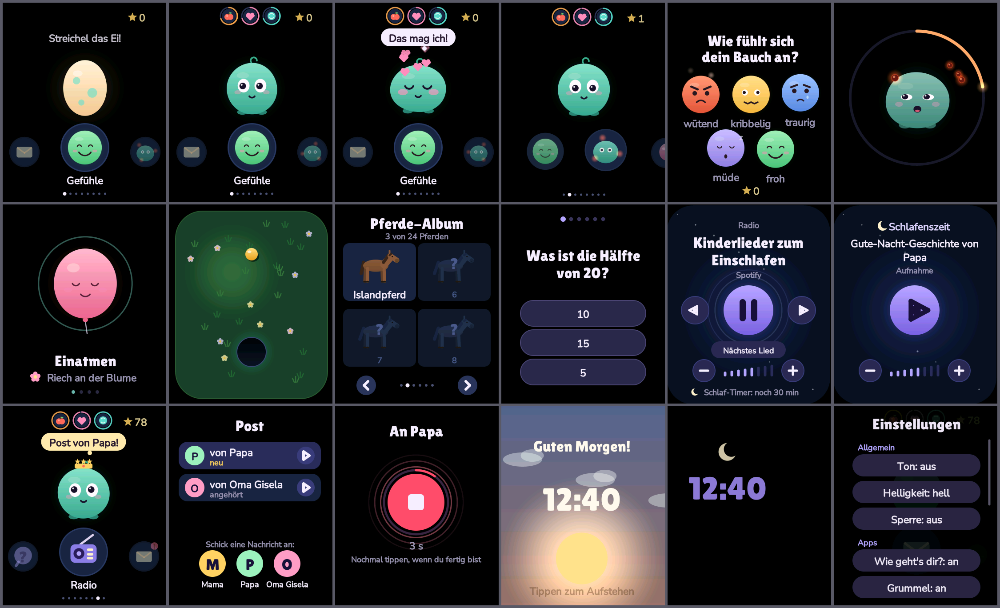
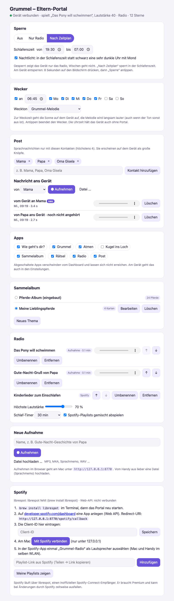
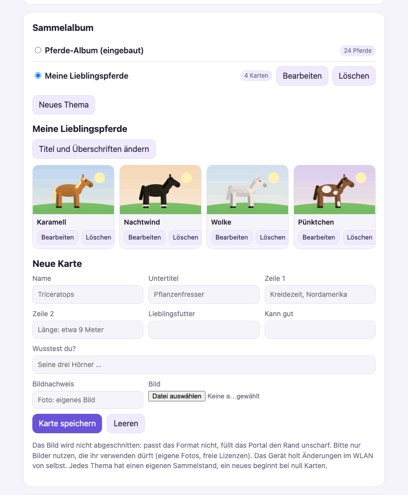
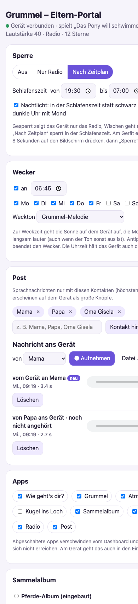

# esp32-kids-adhs

Ein ruhiger Begleiter für Kinder auf dem **Waveshare ESP32-S3-Touch-AMOLED-1.8 (V2)**. Er soll helfen, mit „Wut im Bauch“ umzugehen: Gefühle benennen, Wut wegfüttern, gemeinsam atmen. Dazu kommen ein ruhiges Geschicklichkeitsspiel, Rätsel für die 2. Klasse, ein Sammelalbum, ein Elternradio mit eigenen Aufnahmen und Spotify-Playlists, Sprachnachrichten mit Mama und Papa, ein sanfter Wecker und ein Nachtlicht. Gesteuert wird alles über ein Eltern-Portal im Heimnetz. Es ist eine Unterstützung im Alltag, keine Therapie.



Eltern-Portal (Vorführdaten, Kartenbilder gezeichnet):

| Übersicht | Sammelalbum bearbeiten | am Handy |
|---|---|---|
|  |  |  |

## Dashboard und Apps

Das Gerät startet schwarz, ein Tipp weckt es. Startseite ist das **Dashboard**. Oben wohnt Grummel als kleines Haustier, ähnlich wie ein Tamagotchi, aber ohne Druck:

- Am Anfang liegt ein **Ei** da. Streicheln, Antippen und sanftes Schütteln wärmen es, bis Grummel schlüpft.
- Er **wächst** in drei Stufen (Baby, Kind, groß) durch Pflege: füttern, streicheln, spielen. Die Übungen in den Apps zählen mit.
- Oben stehen drei **Bedürfnisse** als Ringe: Apfel (antippen füttert, der Apfel fliegt in den Mund), Herz (streicheln) und Ball (öffnet das Kugelspiel). Sie leeren sich langsam über Stunden.
- Er reagiert aufs Streicheln (Herzchen steigen auf), Antippen (kichert), Schütteln (Kringelaugen), Klopfen (erschrickt kurz) und auf Stimme (hört zu). Vom Mikrofon wird nur der Pegel ausgewertet, nichts wird aufgenommen.
- Ab und zu fragt er „Wie geht's dir?“. Ein Tipp auf die Blase öffnet den Check-in. Ist die Uhrzeit bekannt, schläft er von 20 bis 7 Uhr.
- Mit den Sternen bekommt er Schmuck: ab 10 eine Schleife, ab 25 eine Blume, ab 50 eine Krone.

Regeln für das Haustier: Grummel stirbt nie, wird nie krank und macht keine Vorwürfe. Leere Bedürfnisse heißen nur, dass er freundlich um etwas bittet.

Unter Grummel liegt ein **App-Karussell**: eine App groß in der Mitte, links und rechts schauen die Nachbarn hervor. Das Display misst nur etwa 29 × 35 mm, ein Raster mit vielen kleinen Symbolen wäre für Kinderfinger zu klein (4 mm). Die Mitte ist etwa 8 mm groß, ihre Tippfläche etwa 13 × 14 mm. Zur Seite wischen dreht das Karussell, Tippen auf einen Nachbarn holt ihn in die Mitte, Tippen auf die Mitte öffnet die App. Das Karussell merkt sich die zuletzt gewählte App. Jede App öffnet bildschirmfüllend, Wischen nach oben oder unten blättert von App zu App, Wischen zur Seite schließt sie. Abzeichen zeigen eine neue Karte oder neue Post.

| App | Was passiert |
|---|---|
| Gefühle (Wie geht's dir?) | fünf Gesichter (wütend, kribbelig, traurig, müde, froh). Das Gerät schickt zum passenden Werkzeug und fragt danach noch einmal nach |
| Grummel | schnell aufs Display tippen, auf den Tisch klopfen oder schütteln: Wutfunken fliegen in Grummel, er wird satt, rülpst, verwandelt die Wut in Blasen und atmet mit („Riech an der Blume“, „Puste die Kerze aus“) |
| Atmen | ein Ballon atmet mit: 4 s ein, 5 s aus, 4 Runden |
| Kugel ins Loch | Kugeln ins Loch rollen, per Finger als Joystick oder per Neigen. Jede Runde hat ihre Landschaft (Wiese, Strand, Holztisch, Nachthimmel). Ohne Zeitdruck, nach 4 Runden kommt eine Pause |
| Rätsel | 5 Fragen pro Runde für die 2. Klasse (Rechnen bis 100, Zählen mit Bild, Tiere und Natur, Zeit, Sprache, Körper). Bei Zählbildern hilft Antippen beim Mitzählen. Ab drei gesammelten Pferdekarten kommt eine Bonusfrage „Welches Pferd ist das?“ mit Foto aus dem Album. Bei falscher Antwort zeigt das Gerät freundlich die Lösung und wartet. Ein Stern pro Runde, egal wie viele richtig waren |
| Sammelalbum | Sammelkarten mit Foto und Infos, eingebaut sind 24 Pferderassen (Typ, Herkunft, Größe, Farben, Wesen, „Wusstest du?“). Eigene Themen (Dinos, Katzen, …) mit eigenen Bildern legen die Eltern im Portal an. Alle 3 Sterne aus den Übungen gibt es eine neue Karte, nie doppelt. Jedes Thema hat einen eigenen Sammelstand |
| Radio | Sender aus dem Eltern-Portal: eigene Aufnahmen (Gute-Nacht-Geschichten, Hörspiele) und Spotify-Playlists. Großer Abspielknopf, Pfeile wechseln den Sender, − und + die Lautstärke (höchstens so laut, wie die Eltern erlauben). Ein Schlaf-Timer blendet nach der eingestellten Zeit langsam aus. Mit SD-Karte laufen die Aufnahmen auch ohne Netz |
| Post | Sprachnachrichten nur mit Kontakten, die die Eltern freigeben (höchstens 4). Oben die Nachrichten an das Kind (antippen spielt ab, das Radio pausiert so lange), unten große Knöpfe für Mama, Papa, … Aufnehmen mit einem großen Knopf, höchstens 30 s, dann „Senden“ oder „Nochmal“. Neue Post meldet Grummel auf dem Dashboard |

Außerdem, ohne eigenes Symbol:

- **Wecker:** zur Weckzeit (Tage wählbar) geht auf dem Gerät die Sonne auf, eine Melodie wird langsam lauter, auch wenn der Ton sonst aus ist und auch bei Sperre. Statt der Melodie geht auch ein Radiosender. Antippen beendet ihn.
- **Nachtlicht:** in der Schlafenszeit zeigt das Gerät statt schwarz eine sehr dunkle Uhr mit Mond, die langsam wandert (Einbrennschutz).
- **Uhrzeit** kommt vom Portal und wird in die Echtzeituhr des Boards (PCF85063) geschrieben, so stimmt sie auch nach einem Neustart ohne Netz.

Sterne gibt es fürs Benutzen der Werkzeuge, nicht fürs „Bravsein“. Gestaltungsregeln: ruhige Bilder, nichts blinkt, kurze Runden ohne Zeitdruck, keine Ranglisten, freundliche Rückmeldungen, Ton startet aus.

## Bedienung

| Geste | Wirkung |
|---|---|
| Tippen, wenn das Display schwarz ist | aufwecken (das Gerät startet schwarz und geht nach 3 min Ruhe wieder aus) |
| im Karussell zur Seite wischen oder Nachbarn antippen | nächste App in die Mitte holen |
| Mitte des Karussells antippen | App öffnen |
| nach oben wischen | nächste App (vom Dashboard aus: die erste) |
| nach unten wischen | vorige App, vor der ersten kommt das Dashboard |
| nach links oder rechts wischen | App schließen, zurück zum Dashboard |
| 3 s lang drücken oder BOOT | Einstellungen für Eltern (Liste lässt sich verschieben): Einstellungen der offenen App, Ton, Helligkeit, Sperre, Apps an/aus, WLAN |

Beim Kugelspiel steuert der Finger die Kugel. Dort wirkt Wischen nur, wenn es am Bildschirmrand beginnt, ebenso auf Grummel selbst (dort ist es Streicheln). Gedimmt reagiert das Gerät normal, nur aus dem Schwarzen heraus weckt die erste Berührung bloß auf.

**Sperre:** „Nur Radio“ oder „nach Zeitplan“ (z. B. 19:30 bis 7:00) zeigt nur noch das Radio, Wischen geht nicht, die Einstellungen kommen erst nach 8 s Halten. Umschalten im Portal oder in den Einstellungen am Gerät. Der Zeitplan braucht die Uhrzeit, die kommt vom Portal.

**WLAN einrichten:** Einstellungen → „WLAN einrichten“. Das Gerät öffnet das WLAN „Grummel-Setup“. Am Handy damit verbinden, die Einrichtungsseite öffnet sich von selbst (sonst `192.168.4.1`), dort Heimnetz und Passwort eintragen. Die Zugangsdaten bleiben im Gerät (NVS). „WLAN: aus“ schaltet den Funk ganz ab. Bluetooth gibt es nicht als Schalter: Der ESP32-S3 kann nur Bluetooth LE, kein Audio-Bluetooth (keine Kopfhörer oder Boxen).

Apps, die aus „Wie geht's dir?“ heraus geöffnet wurden, kehren danach dorthin zurück („Und wie fühlt sich dein Bauch jetzt an?“).

Jeder Check-in wird mit Uhrzeit (falls bekannt) im NVS gespeichert (`ci0`…`ci29`), ohne Namen, für eine spätere Elternseite im Heimnetz.

## Aufbau

```
core/        plattformunabhängig (C++17): Vektor-Renderer, Schriften, Synthesizer, Klopf-/Schüttel-Erkennung, Launcher
             radio_player (Radio-Logik, Ringpuffer), messages (Sprachnachrichten), portal_net (HTTP über BSD-Sockets),
             portal_sync (Sperre, Apps, Wecker, Gerätezustand)
tiles/       home (Dashboard), pet (Haustier-Zustand), checkin, grummel (Büro- und Kinder-Skin), breathe, balance, riddle (Rätsel),
             album, horses (gezeichnete Pferde), radio, post, wakeup (Wecker), icons, oracle (Erwachsenen-Quiz, nicht in der Reihe)
firmware/    Gerät: Rendern auf Kern 1, Display/Eingabe/Audio/Netz auf Kern 0, LittleFS, JPEG, serielle Befehle;
             net.cpp: WLAN, Einrichtungsseite, Portal-Suche per mDNS
lib/amoled18 Board-Schicht: Pins, Display (CO5300), Touch (CST816), IMU (QMI8658), Audio (ES8311)
sim/         Simulator für den Mac (SDL2)
tools/       mkfont.swift (Schriften), horses.py (Pferde-Album), quiz.py (Fragenpakete), serial_log.py, portal/ (Eltern-Portal)
quiz/        Fragenpakete als JSON: kinder-2klasse (Rätsel-App, eingebaut), 2026-10-a (Erwachsene)
licenses/    Schriftlizenz (SIL OFL 1.1)
```

Der Renderer zeichnet in voller Auflösung (368×448) kantengeglättete Formen: Ellipsen mit Verlauf, wabernde Blobs, Leuchten, Bögen, Kapseln, abgerundete Rechtecke, Sterne, Bilder und Text. Gerastert wird in Bändern zu 16 Zeilen im internen RAM. Der Display-Task schiebt das vorige Band per QSPI-DMA, während Kern 1 das nächste rechnet. Alle Kacheln laufen mit 30 fps.

## Bauen

Simulator (braucht SDL2, z. B. `brew install sdl2`):

```bash
make -C sim && sim/dksim
```

Maus = Finger, Leertaste oder 1/2/3 = klopfen, T = Tastatur tippen, X = schütteln, M = sprechen, Pfeiltasten = neigen, B = BOOT, P = Bildschirmfoto. `sim/dksim --screens <ordner>` spielt alle Abläufe durch, speichert Bilder und meldet jeden Text, der über den Rand oder in die runden Ecken ragt. Dazu prüft es Wischen, Sperre und Radio.

Gerät (PlatformIO):

```bash
pio run -t upload
```

## Eltern-Portal und Radio

Das Portal läuft auf dem Mac im Heimnetz (Python, ohne Zusatzpakete; ffmpeg für die Umwandlung):

```bash
tools/.venv/bin/python tools/portal/portal.py
```

Dann `http://127.0.0.1:8770` am Mac oder `http://<mac-name>.local:8770` vom Handy. Dort:

- **Post:** Kontakte anlegen, Nachrichten ans Gerät aufnehmen oder hochladen, Nachrichten vom Gerät anhören (neue sind markiert)
- **Wecker** (Uhrzeit, Tage, Weckton) und **Nachtlicht**
- **Apps** einzeln an- und abschalten (abgeschaltete verschwinden vom Dashboard und sind auch per Wischen nicht erreichbar)
- **Sammelalbum:** aktives Thema wählen, eigene Themen anlegen (Titel, Name auf dem Dashboard, Rätselfrage, Überschriften der Rückseite), Karten mit Bild anlegen und bearbeiten. Bilder werden nicht abgeschnitten (Rand unscharf gefüllt, braucht Pillow aus `tools/.venv`). Das Gerät lädt das aktive Thema im WLAN von selbst in seinen Speicher (`/album`, höchstens 48 Karten), neue Themen beginnen bei null Karten
- **Sperre** aus, „Nur Radio“ oder nach Zeitplan
- **Sender** anlegen, umbenennen, sortieren, entfernen; höchste Lautstärke, Schlaf-Timer
- **Aufnahmen** direkt im Browser aufnehmen (am Mac unter 127.0.0.1, Browser verlangen dafür eine sichere Adresse) oder Dateien hochladen (MP3, M4A, Sprachmemo …). ffmpeg wandelt sie in 16 kHz mono um und gleicht die Lautheit an.
- **Spotify-Playlists** per Link oder aus „Meine Playlists“

Das Portal meldet sich per Bonjour als `_grummel._tcp` an, das Gerät findet es ohne Adresse. Es fragt alle 2 s nach Sendern, Sperre und Uhrzeit und holt den Ton als 16-Bit-PCM-Strom (`/radio/<id>.pcm`). Ist der Mac aus oder schläft, schläft auch das Radio. `tools/portal/autostart.sh` startet das Portal beim Anmelden am Mac (LaunchAgent, `autostart.sh aus` entfernt ihn).

**Spotify** (braucht Premium) läuft über [librespot](https://github.com/librespot-org/librespot), einen inoffiziellen Spotify-Connect-Empfänger. Er wird nicht von Spotify unterstützt und kann bei Änderungen zeitweise ausfallen. librespot meldet sich als Lautsprecher „Grummel-Radio“, ffmpeg wandelt den Ton um, das Portal reicht ihn ans Gerät weiter. Gestartet und gesteuert wird über die Spotify-Web-API:

1. `brew install librespot`, Portal neu starten
2. Auf developer.spotify.com eine App anlegen (Web API), Redirect-URI `http://127.0.0.1:8770/spotify/callback`, Client-ID im Portal eintragen
3. Am Mac im Portal „Mit Spotify verbinden“
4. In der Spotify-App einmal „Grummel-Radio“ als Lautsprecher wählen

Alles, was das Portal speichert (Aufnahmen, Einstellungen, Spotify-Anmeldung), liegt in `tools/portal/daten/` und nicht im Repository.

Test ohne Gerät: `sim/dksim --portal-test` holt Sender und Kartenthema vom laufenden Portal, spielt den ersten Sender 3 s ab, misst den Ton und zählt die Kartenbilder. Im interaktiven Simulator spielt das Radio über die Mac-Lautsprecher (Portal-Adresse in `DK_PORTAL`, sonst 127.0.0.1).

### SD-Karte (optional)

Das Board hat einen TF-Slot (SDMMC 1-Bit: CLK 2, CMD 1, D0 3). Steckt eine Karte drin (FAT32), kopiert das Gerät alle Aufnahmen aus dem Portal (`/radio`) und die Sprachnachrichten (`/nachricht`) dorthin und spielt sie von der Karte, auch wenn der Mac aus ist. Die Senderliste für den Start ohne Netz liegt in `/radio/quellen.txt`. Spotify geht offline nicht.

### Tonies?

Tonie-Figuren lassen sich nicht abspielen: Das Gerät hat keinen NFC-Leser, und die Inhalte liegen in der Tonie-Cloud, die sie nur an eine Toniebox liefert. Eigene Hörspiele (z. B. von CDs, die ihr besitzt) gehen als Aufnahme über das Portal.

## Rätsel-Fragen austauschen

Die Fragen stehen in [quiz/kinder-2klasse.json](quiz/kinder-2klasse.json): drei Antworten, die richtige zuerst (das Gerät mischt), dazu eine kurze Erklärung. `"bild": "zaehl:7:apfel"` zeigt sieben Äpfel zum Zählen (auch `stern`, `herz`, `ball`, 1 bis 12 Stück). `quiz.py check` prüft Längen, Zeichen und ob das Bild zur Antwort passt.

```bash
tools/.venv/bin/python tools/quiz.py check  quiz/kinder-2klasse.json
tools/.venv/bin/python tools/quiz.py upload quiz/kinder-2klasse.json      # aufs Gerät, ohne neu zu flashen
tools/.venv/bin/python tools/quiz.py build  quiz/kinder-2klasse.json core/quiz_kids.h QUIZ_KIDS   # als eingebautes Paket
```

## Pferdefotos

Die Fotos sind **nicht** im Repository. `tools/horses.py fetch` holt zu jeder Rasse das Hauptbild des deutschen Wikipedia-Artikels von Wikimedia Commons. Es nimmt nur freie Lizenzen (CC0, CC BY, CC BY-SA, gemeinfrei), schneidet auf 328×196 zu und merkt sich Urheber und Lizenz. Auf jeder Karte steht der Bildnachweis, die Liste der ausgewählten Fotos steht in [tools/horses/BILDNACHWEIS.md](tools/horses/BILDNACHWEIS.md). Ohne Fotos zeigt das Album gezeichnete Pferde.

Eigene Bilder statt der Commons-Fotos: Zu jeder Rasse steht in [tools/horses/BILDPROMPTS.md](tools/horses/BILDPROMPTS.md) eine Bildbeschreibung (ganzes Pferd von der Seite, Querformat, viel Rand), z. B. für einen Bildgenerator oder als Vorlage für eigene Fotos. `horses.py import <ordner>` übernimmt Dateien namens `<Nr>.png` oder `<Nr>-name.jpg` (Nummer wie in der Liste): Das ganze Pferd bleibt sichtbar, der Rand wird mit einer unscharfen Fassung des Bildes gefüllt, und auf der Karte steht „eigenes Bild“.

```bash
python3 -m venv tools/.venv && tools/.venv/bin/pip install pillow pyserial certifi
tools/.venv/bin/python tools/horses.py fetch      # Fotos holen
tools/.venv/bin/python tools/horses.py import bilder/   # oder: eigene Bilder übernehmen
tools/.venv/bin/python tools/horses.py review     # Übersicht ansehen
tools/.venv/bin/python tools/horses.py upload     # aufs Gerät (LittleFS)
```

## Serielle Befehle

115200 Baud, eine Zeile pro Befehl, z. B. `tools/.venv/bin/python tools/serial_log.py 10 status`:

| Befehl | Wirkung |
|---|---|
| `status` | Fragenpaket, Album, Dateisystem, Uhrzeit, Kachel, Mikrofonpegel, Neigung, WLAN, Portal, Radio |
| `log` | Zwei-Sekunden-Protokoll (fps, Zeiten, Ruckler) ein/aus, startet aus |
| `kachel N` | zu Kachel N (0 Dashboard, 1 Gefühle, 2 Grummel, 3 Atmen, 4 Kugel ins Loch, 5 Pferde-Album, 6 Rätsel, 7 Radio) |
| `boot` | BOOT-Taste drücken (Einstellungen auf/zu) |
| `neustart-kind` | Spielstände auf Anfang (Sterne, Karten, Check-ins, Ei), Einstellungen bleiben, dann Neustart |
| `tipp X Y` | Tippen an Display-Position X, Y |
| `wisch X0 Y0 X1 Y1` | Wischen von X0, Y0 nach X1, Y1 |
| `beruehrung` | jede Berührung mit Position ausgeben ein/aus |
| `klopf N` | N künstliche Schläge im Abstand von 250 ms |
| `imu`, `imuraw`, `imureg R V` | Messwerte, Rohregister, Register schreiben (Fehlersuche) |
| `bench`, `prof` | Rasterzeit je Form, Rechenzeit je Formtyp |
| `{"time":N}` | Uhrzeit setzen (Unix-Sekunden, Ortszeit), stellt auch die Echtzeituhr |
| `{"file":"begin",…}`, `F <base64>`, `{"file":"end"}` | Datei ins LittleFS schreiben |

## Stolperfallen auf der Hardware

- **Serielle Ausgabe darf nicht blockieren:** Liest am Rechner niemand mit, läuft der USB-Puffer voll und jedes `Serial.print` wartet. Gemessen wurden Stillstände bis 6 s. Deshalb `Serial.setTxTimeoutMs(0)` und das Protokoll nur auf Befehl.
- **Gleitkomma ist teuer:** Addition und Multiplikation kosten etwa 5 Takte, `sqrtf`, Division, `floorf`/`ceilf`, `fminf`/`fmaxf` und 64-Bit-Multiplikation als Bibliotheksaufrufe 60 bis 90 Takte. In Pixel- und Zeilenschleifen deshalb Ganzzahl-Differenzen, eigene `fsqrt`/`ffloor`/`fmn`, Kehrwerte vorab.
- **`-O2` nur für `core/render.cpp`** (Pragma in der Datei), sonst `-Os`.
- **Das Panel erwartet Big Endian:** `rasterize(..., true)` tauscht die Bytes am Bandende.
- **IMU:** Auf dem Testgerät war der QMI8658 defekt. Eine Achse hing fest, und Neigen kam kaum an. Klopfen und Schütteln funktionieren trotzdem, weil sie nur kurze Änderungen auswerten. Das Ballspiel nutzt deshalb standardmäßig den Finger.
- **JPEGDEC** dekodiert nur Baseline-JPEG. `horses.py` speichert entsprechend.

## Lizenzen

- Schriften: Nunito und Lilita One, SIL Open Font License 1.1, siehe [licenses/OFL-1.1.txt](licenses/OFL-1.1.txt). Die Bitmap-Fassungen in `core/font_*.h` sind daraus abgeleitet.
- ES8311-Treiber (`lib/amoled18/es8311*`): Espressif, Apache-2.0.
- Pferdefotos: nicht enthalten, siehe oben.
